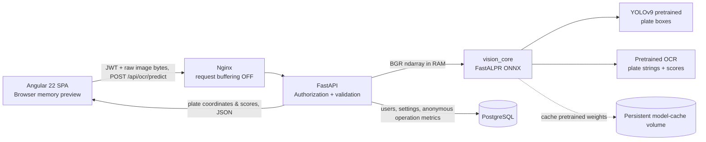

# PlateVision — On-premise License Plate OCR

A Dockerized, **local-first**, multi-user application for detecting and reading vehicle license plates in uploaded images. Includes an Angular UI, FastAPI service, SQLAlchemy + Alembic/PostgreSQL, and a separate pretrained ONNX model adapter. **No uploaded image is saved to disk or PostgreSQL.**

> Delivery status: implementation source with unit tests and Compose setup. Model weights are **not distributed** in this ZIP; pretrained weights must be fetched and cached once (or brought in from an online staging host). Exact model accuracy and latency depend on hardware and plate geography. Validate using representative images before production use.

## Architecture



**Monorepo**

```
apps/web/                     Angular 22 standalone frontend
apps/api/                     FastAPI REST backend and Alembic migrations
packages/vision_core/         independently testable pretrained-model adapter
deploy/nginx/                 same-origin reverse proxy and privacy controls
docs/                         deployment, API and privacy notes
compose.yaml                  on-prem deployment (Postgres + API + UI)
```

## Getting started

**Requirements:** Docker Engine + Docker Compose v2, an x86_64 Linux server (CPU inference), >= 8 GB RAM recommended, outbound Internet **once** for initial Docker images, Python wheels and model weights. GPU is not required. This repo is CPU-only by default.

1. Copy the environment template and configure unique secrets:

   ```bash
   cp .env.example .env
   python3 scripts/configure_env.py
   ```

   The script fills any **empty** `POSTGRES_PASSWORD`, `JWT_SECRET`, and `BOOTSTRAP_ADMIN_PASSWORD` entries with cryptographically random values and prints the initial admin account and password one time. Ensure `.env` is permission-protected and backed up in your secrets manager.

2. Build and launch:

   ```bash
   docker compose up -d --build
   docker compose logs -f api
   ```

3. Open **http://localhost:8080** on the host, and sign in with the bootstrap credentials. The model is initialized when the API starts, downloading weights on first use. The initial container startup may take longer while downloads complete. Subsequent starts reuse the `model-cache` volume.

4. To expose the UI on your LAN, set `WEB_BIND=0.0.0.0` in `.env`, **and terminate HTTPS at an internal reverse proxy**. Browser sessions contain a bearer access token; do not expose this HTTP deployment to untrusted networks.

> If Docker image/model registries are unreachable from the on-prem host, build/pull images and prewarm the **model-cache volume** on an Internet-connected staging host, then import the images and the volume into the isolated environment. Refer to [deployment.md](docs/deployment.md).

### Preload pretrained models

```bash
# On connected staging host or connected on-prem host, after configuring .env:
docker compose build api
docker compose run --rm api python -m app.model_prefetch
```

Models are cached **locally in the `model-cache` Docker volume**; raw plate image uploads never use that volume.

### Dev commands

Backend: PostgreSQL must be running and `DATABASE_URL`, `JWT_SECRET` set. Python 3.11 recommended.

```bash
python -m venv .venv
source .venv/bin/activate
pip install -r apps/api/requirements.txt
pip install -e packages/vision_core
cd apps/api
alembic upgrade head
python -m app.bootstrap
uvicorn app.main:app --reload --no-access-log
```

Frontend in another terminal (Node.js 24.15+):

```bash
cd apps/web
npm install
npm start
# http://localhost:4200 uses proxy.conf.json -> localhost:8000
```

Run unit tests from repo root:

```bash
PYTHONPATH=packages/vision_core/src:apps/api pytest packages/vision_core/tests apps/api/tests -q
```

## Features

- Authenticated SPA and authenticated APIs (only login and internal health endpoint are public). Argon2id passwords, 60-minute JWT default; no default credential committed to the repository.
- Admin / operator / viewer roles. Admin: CRUD users + settings; operator: uploads + dashboard; viewer: dashboard only.
- Upload JPEG / PNG / WebP via `POST /api/ocr/predict`, **raw binary body** (`Content-Type: image/jpeg` etc.), not multipart.
- Detect multiple plates per image, output plate boxes in image pixel coordinates, normalized OCR string, detector score, OCR confidence and available per-character confidences.
- Render bounding boxes on the **temporary browser preview** (the API sends only coordinates, never returns or persists an annotated image).
- Dashboard: daily image volume, plates found, mean duration, mean OCR confidence, 7-day trend, and non-image operation history.
- Runtime threshold and input-size settings in PostgreSQL (no engine retraining), configurable optional storage of numeric operation metadata.
- Single-origin Nginx reverse proxy, request buffering disabled, image byte limit and decoded-pixel limit, model weights on a separate persistent volume.
- Responsive layout for desktop, tablet and mobile.

## Important limitations and next steps

- **Actual box geometry is plate-level, not character-level.** The included pretrained OCR model yields a plate string and sometimes per-character confidences, but no precise per-character coordinates. The UI explicitly labels this. For exact character boxes, add an independently validated character detection/segmentation model to `vision_core` and export verified coordinates; do not simply subdivide the plate box and call those detections.
- **No vector database is needed.** ALPR is object detection + OCR, not vector similarity search. PostgreSQL is enough for users, settings and numeric operational metrics.
- The packaged pipeline is **CPU-only**. For NVIDIA acceleration, use compatible ONNX GPU runtime images and configure execution providers in `vision_core`; verify CUDA compatibility first.
- Model weights are fetched on first initialization, so the server needs Internet access **once** or an imported warmed model volume. Model inference accuracy for **Vietnamese two-line plates, motorcycles, oblique angles and night images** must be tested; the default global OCR model isn't specifically optimized for every local plate format.
- Model performance / hardening: inference is intentionally serialized per API process for predictable concurrency. For production throughput, introduce a bounded job queue and multiple isolated inference workers instead of blindly increasing Uvicorn workers.
- For production, front with TLS, add network segmentation, monitoring, image-access policy, data retention policy, audit requirements and regular dependency security review. Session token uses `sessionStorage`, not persistent localStorage; short expiry and HTTPS mitigate (but do not eliminate) token theft risks.

## API quick example

```bash
# Set credentials from your .env; don't commit or paste secrets in shared logs.
TOKEN=$(curl -fsS http://localhost:8080/api/auth/login \
  -H 'Content-Type: application/json' \
  --data '{"email":"admin@example.local","password":"REPLACE_FROM_ENV"}' \
  | python3 -c 'import sys,json;print(json.load(sys.stdin)["access_token"])')

curl -fsS http://localhost:8080/api/ocr/predict \
  -H "Authorization: Bearer ${TOKEN}" \
  -H "Content-Type: image/jpeg" \
  --data-binary @my_plate.jpg
```

To test the complete running stack: `python3 scripts/smoke_test.py --email admin@example.local --image ./plate.jpg` (prompts for password).
Full endpoint specifications: [API reference](docs/api.md). Privacy and deployment details: [deployment notes](docs/deployment.md).

## Third-party models and attribution

[FastALPR](https://github.com/ankandrew/fast-alpr) (MIT), with default pretrained `open-image-models` detector and `fast-plate-ocr` recognizer. Review individual upstream model-weight licenses and origin/usage restrictions before commercialization. The model weights are not bundled.
